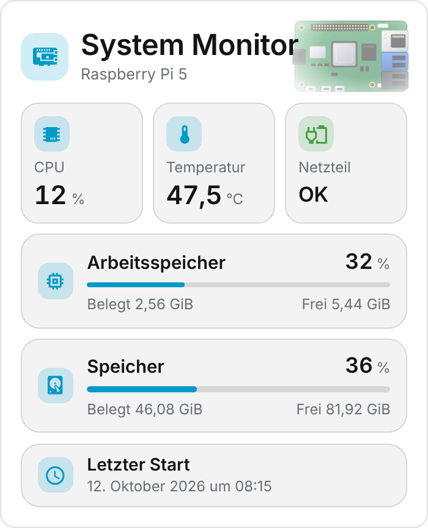

  

# System Monitor Card

**English** | [Deutsch](https://github.com/BeGiBue/home-assistant-system-monitor-card#deutsch)

## English

Compact card for monitoring the host Home Assistant runs on, preconfigured for a **Raspberry Pi 5** with the **System Monitor** integration.

### Features

- Tiles for CPU usage, CPU temperature and power supply status
- Memory and storage bars with percentage, used and free
- Warning colors by threshold; last boot in your Home Assistant format
- Tapping a value opens the entity's details
- Follows your theme; visual editor with native entity pickers

The card is shown in German when Home Assistant is set to German, and in English otherwise.

### Requirements

- **System Monitor** integration (processor, memory, disk, last boot).
- Optional: **Raspberry Pi Power Supply Checker** integration for the power supply status (`binary_sensor.rpi_power_status`).

Independent community project, not affiliated with, endorsed or published by Raspberry Pi Ltd or Home Assistant. **Raspberry Pi** is a trademark of Raspberry Pi Ltd. License: [AGPL-3.0-only](https://github.com/BeGiBue/home-assistant-system-monitor-card/blob/main/LICENSE).

## Deutsch

[English](https://github.com/BeGiBue/home-assistant-system-monitor-card#english) | **Deutsch**

Kompakte Karte zur Überwachung des Hosts, auf dem Home Assistant läuft, vorkonfiguriert für einen **Raspberry Pi 5** mit der Integration **System Monitor**.

### Funktionen

- Kacheln für CPU-Auslastung, CPU-Temperatur und Netzteilstatus
- Balken für Arbeitsspeicher und Speicher mit Prozent, Belegt und Frei
- Warnfarben nach Schwellwerten; letzter Start im Format von Home Assistant
- Tippen auf einen Wert öffnet die Details der Entität
- Folgt dem Theme; grafischer Editor mit nativen Entity-Pickern

Die Karte erscheint auf Deutsch, wenn Home Assistant auf Deutsch eingestellt ist, sonst auf Englisch.

### Voraussetzungen

- Integration **System Monitor** (Prozessor, Speicher, Festplatte, letzter Start).
- Optional: Integration **Raspberry Pi Power Supply Checker** für den Netzteilstatus (`binary_sensor.rpi_power_status`).

Unabhängiges Community-Projekt, ohne Verbindung zu Raspberry Pi Ltd oder Home Assistant und von beiden weder unterstützt noch herausgegeben. **Raspberry Pi** ist eine Marke der Raspberry Pi Ltd. Lizenz: [AGPL-3.0-only](https://github.com/BeGiBue/home-assistant-system-monitor-card/blob/main/LICENSE).
